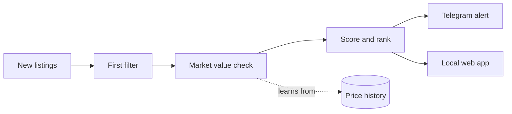

<p align="center">
  
</p>

<p align="center">
  
  
  
  
  
</p>

A personal tool that watches [Andele Mandele](https://www.andelemandele.lv), Latvia's largest second-hand marketplace, and tells me when a piece of clothing is listed well below what it is worth, so I can buy it and resell it at a fair price.

As far as I know, nothing like it exists for Andele.

> **The source code is private.** This page shows what the project does, not how.

## What it does

| | |
|---|---|
| 🔎 **Finds deals** | Reads new women's and men's clothing listings and keeps the ones priced far under their value. |
| 📊 **Knows the market** | Values each item from what the same brand and garment type really goes for on Andele, adjusted for condition. |
| 📱 **Alerts my phone** | Sends the best finds to Telegram with the price, the expected margin and a ready-made message for the seller. |
| 🧾 **Explains itself** | Every deal lists the listings it was compared with. Too little data means "unchecked", never a guess. |
| 🚩 **Flags risk** | Warns about likely fakes and risky sellers instead of promoting them. |
| 💶 **Helps me resell** | Suggests what to list an item at, when to lower it, and drafts a title and description. |
| 📈 **Tracks profit** | Keeps what I bought, what it cost and what it sold for, with profit after shipping and fees. |

## What an alert looks like

An invented example in the real format:

```
Tommy Hilfiger džemperis
12 € · ~16 € margin
Tommy Hilfiger · Size M · Lietots, lieliskā stāvoklī
Worth ~32 €: 7 similar listings sold for 38 € (median)
Try 10,20 € first
```

## How it works



## Built to be a good guest

- Anonymous and read-only: it never logs in, messages or buys.
- Slow on purpose: one request at a time with long pauses, and a hard daily limit.
- Respects `robots.txt`.
- Stops by itself for hours at the first sign the site doesn't want it there.

## Under the hood

- **Python, standard library only**: no frameworks and no third-party packages.
- **SQLite** for listings, price history and deals.
- **Runs around the clock on an old Android phone** (Termux), with a small local web app and a Telegram bot.
- **188 automated tests**, all offline.

## Status

Running daily since November 2026. Personal use only; no data is published or shared.

---

<p align="center"><sub>© 2026 Xanfiend. All rights reserved. No part of this project is licensed for reuse.</sub></p>
